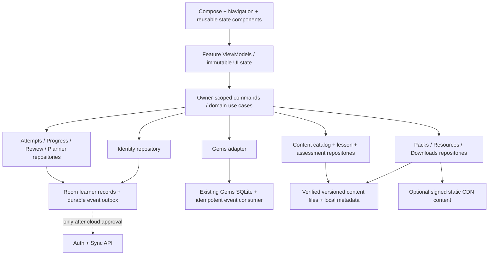

# EN.MATH — Target Architecture Draft

2026-10-25 · **تصميم مقترح، لا Backend مجهز ولا تبعيات جديدة مثبتة**. يتبع حسابًا مستقلًا ثابت المرحلة، ويحفظ legacy والمعلم. الاعتماد عبر D01..D16 في [القرارات](../PRODUCT/ENMATH_OPEN_DECISIONS.md).

## 1. Current architecture مقابل الهدف

الحالي: MainActivity → ENMathApp ينشئ LocalDemoRepository → AppViewModel/LearningState → شاشات Compose. التخزين enmath_demo وenmath_personal_<SHA256(owner)> عبر SharedPreferences وProductCodec JSON، وقاعدة enmath_local_gems_v1.db مستقلة. Android module واحد، Kotlin/Compose/Navigation/ViewModel/StateFlow. app/build.gradle.kts بلا Room/DataStore/WorkManager/network/Auth SDK؛ main/debug manifests لا يضيفان INTERNET. هذا فحص للمصادر وليس merged manifest جديدًا.

الهدف يحافظ على module app أولًا؛ فصل منطقي packages/use cases/repos لا إعادة كتابة واسعة أو microservices. الاستبدال تدريجي لأن UI/graphs/rules تقرأ Seed مباشرة. مصدر القراءة المحلي المتحقق منه أساس العرض، كما توصي [بنية Android offline-first](https://developer.android.com/topic/architecture/data-layer/offline-first).

## 2. حدود العقود المقترحة

الأسماء التالية الهدف، ليست APIs موجودة. كل write يرجع Saved/AlreadyApplied/Rejected/StorageFailure مع acknowledgment دائم، ويأخذ owner وcommandId ثابتين. StateFlow/Flow للقراءة وإعادة الإسقاط؛ لا changeProduct snapshot مكشوفًا كواجهة Backend.

| العقد | عمليات أساسية | قواعد/خطأ | المستهلك الحالي الذي يحتاج adapter |
|---|---|---|---|
| IdentityRepository | createGuest(stage), selectLearner, linkVerifiedAccount, listLocalLearners | stage immutable، UUID، no name/email-derived owner؛ Conflict/UnownedLegacy | ENMathApp، LocalDemoRepository، LocalGemsPolicy |
| ContentCatalogRepository | observeCatalog(stage,edition), resolve(stableId,revision) | PublishedOnly، UnavailableStage/Version/Rights | LearningState.books/topics/questions، Home/Curriculum/ProductGraphs |
| LessonRepository | loadBlocks, saveResume, complete | version pinned، completion ≠ mastery، NotInstalled/UnsupportedBlock | CourseScreens، InteractiveLessonVM |
| AssessmentRepository | startSession, submitAnswer/attempt | attemptId+rubricRevision، assistance/mode، idempotent | QuizVM، AppViewModel.recordPractice |
| ProgressReviewRepository | appendEvidence, observeProgress, scheduleReview | append-only attempts؛ projections rebuildable؛ no seed fallback | LearningRules، ProgressScreen |
| PlannerRepository | createPlan, addGoal, recordQuantity, carry, rescope, undo | manual/linked، لا جمع لوحدات مختلفة، timezone، journal؛ no rewards | جديد؛ Home يعرض projection |
| MotivationRepository | eligibleMessage, recordShown, earnBadge | cadence وopt-out، event provenance | نصوص تشجيعية تتحول تدريجيًا |
| GemsRepository | consumeVerifiedEvent, readLedger, unlock | owner alias mapping؛ unique achievement؛ ledger invariant | LocalGemsCoordinator/SQLiteLocalGems |
| LibraryRepository | listRightsCleared, bookmark, savePage | alwaysFree enforce، stage، licensed only | LibraryScreen بدل اشتراط الصف |
| PackRepository | enqueue, pause, resume, verify, activate, repair, deleteContent | durable state، checksum+signature، safe extract، pins | جديد؛ current APK assets ليست packs lifecycle |
| SettingsRepository | theme/language/download/motivation prefs | local persisted، preference ≠ scheduled notification | SettingsScreen/LocalDemoRepository |
| AuthRepository + SyncRepository | authenticate/refresh/revoke/recover/export/delete/sync | اختياري؛ server authorization، rate limits، no client role trust | AuthViewModel يعاد ربطه لاحقًا؛ غير موجود الآن |

أنواع أخطاء متفق عليها: Validation/UnsupportedMath/UnsupportedContent/StageMismatch/NotInstalled/Network/NoSpace/CorruptLocalData/Unauthorized/Conflict/VersionMismatch. UI لا تترجم كل فشل إلى «لا توجد بيانات».

## 3. نموذج البيانات والعزل

| المجال | كيانات الهدف ومفاتيحها | النزاهة |
|---|---|---|
| الهوية | LearnerIdentity(localLearnerId UUID, stage, createdAt, kind), AccountLink(accountId, localLearnerId, provider), IdentityAlias(legacyKey,learnerId,status) | unique account link، stage ثابتة، contact منفصل؛ aliases مؤكدة فقط |
| المنهج | Curriculum(country,track,stage) → Edition(id,year,source,rights) → Subject → Book? → Unit → Lesson(id,revision) ↔ Skill | IDs مستقرة لا عنوان/ترتيب؛ Subject manual لا يدعي كورسًا منشورًا |
| المحتوى | LessonBlock(id,type,version,payload,a11y), Question(id,revision,skillId,source,rubric), AssessmentDefinition | schemaVersion ≠ contentVersion؛ draft/reviewed/published، صلاحية عارض |
| السجلات | LearningEvent(eventId,owner,target,revision,type,at), Attempt(attemptId,owner,questionRevision,answer,result,assistance,mode,rubricVersion), LessonProgress(owner,lesson,resume,completion) | unique(owner,commandId)، immutable history، owner FK، pinned versions |
| الإتقان/المراجعة | SkillEvidence(owner,skill,attemptId,policyVersion), MistakeReview(id,owner,originalAttempt,due,state), MasteryProjection | projection لا يكتب بدل الأدلة؛ evidence مستقل عن completion |
| المخطط | StudyPlan(id,owner,period,mode,start,end,timezone,state), Goal(id,plan,subject,title,unit,target,manualOrLinked), Task, OptionalSession | target positive؛ الكمية decimal محددة حسب الوحدة؛ الوقت اختيار لا افتراض |
| تاريخ الخطة | GoalProgressEvent(id,owner,goal,delta,source,key), CarryOverEvent(id,sourceGoal,destPlan,remaining,decision), GoalRevision | تعديل الهدف لا يمحو التاريخ؛ نقل idempotent لا ينسخ الإنجاز |
| التحفيز | CuratedMessage(id,locale,context), DisplayEvent(owner,message,trigger,at), AchievementDefinition, EarnedAchievement(owner,id,event) | opt-out، cap/cadence، قاعدة versioned، no manual reward |
| الجواهر | GemOwnerAlias + الجداول الستة القائمة + EventDeliveryJournal | balance=sum rewards−sum unlock prices؛ لا مفاتيح من pack revision؛ لا جمع رصيدين |
| المكتبة | Resource(id,stage,subject,source,license,alwaysFree,revision), ReadingPosition(owner,resource,page), Bookmark(owner,type,target) | alwaysFree لا bypass له بالمتجر؛ license review قبل نشر |
| الحزم | PackManifest(pack,version,edition,schema,minApp,locale,files,deps,signature), Installation(pack,version,path,state), VersionPin(session,version), DownloadJob | unique verified activation؛ لا FK حذف cascade من المحتوى إلى التعلم |
| التشغيل/الهجرة | MigrationJournal(step,status,sourceFingerprint,targetVersion,counts), ContentAlias(old,canonical,revisionRule), ReviewLog/Errata | restartable، preserve originals، ambiguity quarantine |

ملكية كل معلومة شخصية ownerId؛ database indexes وunique constraints عليه مع target. Query بلا owner ممنوعة في عقود الطالب. الجهاز المشترك يحتاج اختيار جلسة آمن وواضح؛ local profile لا يثبت مصادقة خادمية. لا تعميم account متعدد المراحل أو محفظة مشتركة من التقرير القديم.

## 4. جرد legacy وترحيله غير المدمر

المخازن المؤكدة من المصدر:

| المخزن | المفاتيح/الجداول | خطر الانتقال |
|---|---|---|
| enmath_demo | name/email/role/theme/language/onboarded، completed/last legacy، product_v1، personal_legacy_owner، personal_legacy_record_id، student_snapshot_files | completed/last تقرآن legacy؛ هوية legacy الافتراضية ahmed عند غياب session؛ لا تخمين مرحلة/مالك |
| enmath_personal_<hash> | product_v1، completed، last، student_record_id، record_owner | hash ليس هوية مستقلة؛ تغيير بريد يغير المفتاح؛ writes متعددة apply |
| product_v1 JSON | version=1، questions/attempts/classes/assignments/submissions/resources/notes/history/activity/read/lessons/problems/searches/enabled/reminder | version محفوظ لكن لا dispatcher migration؛ load failure→seed؛ arrays قد تتضخم |
| enmath_local_gems_v1.db | gem_accounts/exclusions/rewards/unlocks/lessons/assessments | owner=email؛ transactions محلية صحيحة لكن cross-store غير ذرية؛ onUpgrade يرفض |
| SavedStateHandle/rememberSaveable | درس/quiz/solver/UI، بعض owner hints | ليس دفتر محاولات دائمًا؛ لا يضمن العودة بعد force stop/fresh start |

التسلسل المقترح بعد الإذن: fixture مجهول الملكية/صاحب مؤكد/زائر/عدة حسابات/JSON تالف/ledger special → snapshots داخل اختبارات معزولة مع SHA256 → mapping مؤكد → إنشاء قاعدة جديدة إضافةً → import transactions + journal → مقارنة counts/owner/completion/attempts/balances/unlocks → تفعيل القراءة الجديدة بعد تحقق → احتفاظ آمن بالأصل في نافذة التوافق. فشل القراءة يحجر المصدر ويمنع overwrite؛ initial empty الجديد يختلف عن corrupt existing.

لا `fallbackToDestructiveMigration` ولا `clear()` أو حذف قاعدة كتعافٍ. Room يدعم مسارات migration واختبارها؛ ملف schema واختبارات migration شرط قبل تغيير الإصدار. [توثيق Room الرسمي](https://developer.android.com/training/data-storage/room/migrating-db-versions).

المرحلة القديمة غير مثبتة في User؛ لا تُنسب بياناتها تلقائيًا لتاسع/بكالوريا من عناوين Demo. يلزم D03 ومسار توضيح/اختيار مع عدم تغيير ملكية الحساب تلقائيًا. downgrade إلى APK أقدم لا يُوعد به بلا compatibility policy؛ rollback للتفعيل قبل حذف الأصل، وإصلاح forward migrations للنسخ المنشورة.

## 5. المعاملات وعقد الأحداث

التعلم/المحاولة وحدثه يسجلان transaction واحدة داخل مخزن التعلم المستهدف. consumer للجواهر يقرأ outbox ويكتب مكافأة بمفتاح achievement ثابت في SQLite؛ acknowledgement منفصل يعاد بعد crash. التسليم at-least-once مع idempotency، وليس ادعاء exactly-once بين قاعدتين. crash بعد grant قبل ack لا يكرر المكافأة. الجلسة تربط owner عند البدء وتعيد التحقق **قبل كل كتابة تعليمية**، لا قبل الجواهر فقط. الحساب المتغير يرفض الإرسال أو يحتفظ بمسودة للمالك الأصلي وفق UX معتمد.

الحالي completeRecorded وrecordPractice يكتبان التعلم قبل فحص attributable للجواهر؛ لذلك الحارس الحالي ليس ضمان ملكية للمحاولة/الإكمال. النتيجة Submitted تعني قبولًا وعودة الدالة، لا قرصًا دائمًا ولا ledger success.

## 6. Content Pack contract / publication

Manifest: packId/editionId/stage/bookId/unitId/schemaVersion/contentVersion/minAppVersion/locale/publishedAt/keyId/files(path,type,compressedSize,expandedSize,SHA256)/dependencies/sourceRefs/rights/reviewer/signature. exact canonical serialization والتوقيع/rotation قرار تصميم D11، لا خوارزمية مرتجلة. secret key للنشر خارج APK؛ public verification key في التطبيق. SHA256 يثبت سلامة البايتات وحده ولا يثبت جهة النشر.

حياة مستديمة: notInstalled → queued → downloadingTemp → verifying → staged → active؛ failure/pause/cancel/retry حالات محفوظة. HTTP Range مع ETag/If-Range إن دعمه الخادم، وإلا restart معلن. no-space budget يشمل temp + expanded + retained version. safe extract يمنع absolute/parent paths وsymlinks وZIP bombs والأنواع غير المسموحة وتجاوز counts/sizes. لا Kotlin/JS/HTML نشط محمّل. KaTeX المرفق أصل محلي لا يُفتح منه مسار تنفيذ عشوائي من pack.

التفعيل لا يسبق اكتمال التحقق؛ metadata transaction + directory rename مع crash journal وتعافٍ من orphan directories، فلا ادعاء transaction مشتركة بين filesystem وDB. update يبقي النسخة المستخدمة pinned؛ delete يزيل bytes/install فقط ويحافظ على Attempts/Planner/Gems/Bookmarks وmetadata خفيفة. تغيير سؤال معيب ينتج revision/errata، وسجلات الماضي لا تعاد كتابتها ولا تكافأ مجددًا.

Publisher offline CLI مستقبلًا: source intake → coverage/pages/skills → original authoring → independent math/rights review → schema/rubric/a11y validation → deterministic package → sign → staging → approved catalog → publish. rollback كتالوج إلى نسخة متوافقة مع الاحتفاظ بالأحداث. لا Admin/Teacher role في APK للنشر.

## 7. LOW-COST STRATEGY: ثلاثة سيناريوهات

هذه مقارنة معمارية، لا توصية شراء أو التزام ميزانية. راجعت المصادر الرسمية في 2026-10-25؛ لا تثبت هذه الصفحات أهلية الاستخدام أو التسليم من سوريا.

| السيناريو | المكونات | ماذا يوفر/لا يوفر | نموذج التكلفة والمخاطر |
|---|---|---|---|
| A — local + content CDN | Room/SQLite/files + signed catalog + R2 أو Bunny + domain | تعلم ومخطط ومراجعة offline بعد التحميل؛ لا Auth/backup cloud | storage+requests+public delivery+domain+editorial/support؛ خطر فقد الجهاز ووصول CDN |
| B — A + API خفيف | Worker/API محدود لبلاغات/توافق إصدارات أو entitlement معتمد | فقط احتياج فعلي؛ static JSON لا يحتاج DB/API بذاته | يزيد requests/compute/logging/abuse protection/ops؛ لا ندعي هوية/Sync تلقائيًا |
| C — A/B + Auth & Sync | مزود Auth + Postgres/API + owner authorization/RLS + outbox + backups | جلسة واستعادة وتعدد أجهزة بعد اختبارات؛ stage lock يطبق بالخادم | Auth MAU ورسائل استعادة/SMS وDB/compute/backup/transfer/support؛ تعارض/حذف/أهلية واستعادة سوريا |

R2 Standard المعلن: 0.015 دولار/GB-month، Class A 4.50/مليون وB 0.36/مليون، Internet egress مجاني مع شروط الصفحة؛ free tier Standard: 10GB-month و1M A و10M B. لا يشمل ذلك domain أو API إضافي أو التشغيل البشري. [Cloudflare R2 pricing](https://developers.cloudflare.com/r2/pricing/).

Bunny Standard HDD المعلن: 0.01 دولار/GB لكل منطقة لأول منطقتين، 0.005 لكل منطقة إضافية، حد أدنى شهري 1 دولار؛ تكلفة CDN bandwidth غير مشمولة بسعر التخزين. لا تُقارَن هذه الأرقام وحدها بكلفة R2 الإجمالية. [Bunny Storage pricing](https://bunny.net/pricing/storage/).

نموذج دون ميزانية مختلقة: S=sum(packs+retained versions+resources) GB؛ T=active learners×packs per learner×size×retry factor؛ A/B=أحداث نشر/قراءات فعلية؛ C_A=storage(S)+requests(A,B)+domain+operations؛ C_B=C_A+API+logs؛ C_C=C_B+Auth+recovery+DB+backups+sync+support. لا أعداد طلاب أو حجم pack أو سعر SMS مثبت الآن. إعادة فحص الأسعار والأهلية قبل أي تعاقد؛ free tier ليس وعد فاتورة صفرية.

benchmark المقترح بعد موافقة: شبكتان خلويتان/اتصال ثابت متاحان، DNS/TLS/status/range/resume، ملفات نص/PDF وأحجام تمثل المحتوى، أوقات وفشل وإعادة محاولة وكلفة نقل، وصول لوحة المشغل ووسيلة الدفع، recovery على قناة حقيقية. لا اختبار شبكة سوري أو SMS أو تسجيل خدمة نفذ هنا. اختيار مزود يتبع الدليل لا اسم الخدمة.

## 8. Auth/Sync المشروط والخصوصية

لا نشر phone/password قبل حسم D02 والتأكد من تحقق ملكية الرقم والاستعادة؛ password لا يثبت الرقم. accountId مستقل وstage immutable enforced server-side؛ أي مسار مركب phone+accountSelector يحتاج دعمًا صريحًا من المزود/الخادم، لا alias email مزيفًا بلا استعادة. لا نخزن password أو admin/service keys في APK/Git. Session refresh/revoke/logout، rate limits، authorization لكل owner، استعادة لا تكشف وجود الحساب، وسجلات تدقيق قليلة البيانات.

Sync: events UUID وserver receipt، محاولات append-only، unique achievement IDs، conflict planner بتعارض صريح أو revisions لا snapshot last-write-wins؛ user deletion/export يحترم policy والفصل بين الأجهزة. لا ترفع balance محليًا كحقيقة اقتصادية؛ لا merge للأرصدة. guest claim له journal وتفويض ومراجعة مرة واحدة.

الأمن: TLS، least privilege، فصل keys النشر عن التنزيل، ملفات خاصة بالتطبيق، validation وallowlist URLs، لا كلمات سر بالlogs، خصوصية عربية واضحة ومدة احتفاظ ومسار حذف عند تشغيل الحساب. الجمهور القاصر وقناة التوزيع وسياسات المتجر تحتاج مراجعة مستقلة قبل النشر. لا بيان امتثال قانوني مؤكد في هذه المسودة.

الويب المستقبلي يشترك في schemas/IDs/revisions/API contracts فقط؛ لا تنفيذ واجهة ويب الآن. كود المعلم وبيانات صفوفه يبقيان legacy محفوظين خلف حد منفصل، ولا teacher dependency في المحتوى العام أو المكتبة.

## 9. حدود الإنجاز

لم يُنشأ Room/Backend/CDN أو ملفات migration أو secrets أو packs فعلية. العقود والكيانات أعلاه target. الاعتماد الأول المطلوب D01/D03/D04/D05 ثم P0؛ المصادر الرسمية تؤيد التصميم العام ولا تثبت نجاحه في تطبيقنا أو سوريا.
