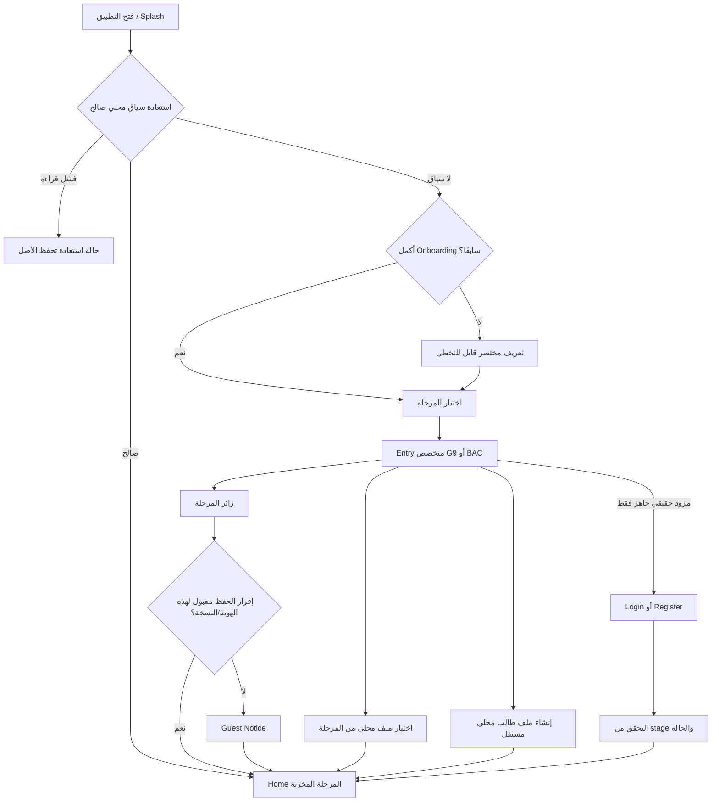

# EN.MATH — Phase 1: مواصفات UX للمرحلتين

26 أكتوبر 2026 · v1.0 · **مواصفات مستهدفة للمراجعة، لا شاشات منفذة**. [فهرس الحزمة والقرارات](ENMATH_PHASE1_REVIEW_AND_DECISIONS_2026-10-26.md).

## 1. حدود التجربة وقواعد المصدر

ثلاث تسميات منفصلة: «زائر التاسع/زائر البكالوريا»، «ملف طالب محلي»، «حساب موثّق» مستقبلًا. المحلي محفوظ على الجهاز فقط، والزائر بلا Gems. لا رسوم دخول أو أزرار إرسال/نجاح تدعي خدمة غير متصلة. المحتوى والتقدم والمراجعة والخطة تأتي من owner/stage/edition الصحيحة؛ فراغ المصدر يعني Empty مفهومًا، وليس صفر إتقان أو نتائج seeded.

الواجهة الحالية: LocalIdentityScreen تسبق NavHost؛ G9 محجوب لعدم توفر المحتوى؛ BAC تستخدم StudentLearningHome/CurriculumScreen التجريبيتين. المواصفات أدناه الهدف؛ حتى تنفيذ catalog/Planner/review لا يجوز ربط CTA بعرض شكلي يوحي بإنجاز الوظيفة.

## 2. رحلة البداية والاستعادة



السياق الصالح يعني profile معروف وsnapshot صالح وstage معروفة. غياب edition معتمدة لا يمنع فتح الملف أو محفظته؛ يوقف ادعاء منهج معتمد ويعرض CatalogUnavailable أو ReviewRequired. تلف ملف لا يبرر اختيار ملف آخر أو stage أخرى تلقائيًا. جلسة معلم قائمة تبقى في المسار القائم ولا تمر باختيار مرحلة الطالب.

| حالة العودة | النتيجة المطلوبة |
|---|---|
| آخر زائر/طالب محلي نشط صالح | Home لنفس UUID والمرحلة، دون إنشاء ملف أو إقرار مكرر |
| خروج صريح | ChooseStage مع «اختيار ملف محلي»؛ لا يُفتح الملف الذي خرج منه تلقائيًا |
| تبديل من Profile | E11؛ الحالي يبقى فعالًا حتى تأكيد الهدف وحفظ العملية، إلغاء يعيد الشاشة السابقة |
| Stage مختارة مختلفة عن ملف سابق | إنشاء/اختيار مساحة مختلفة بعد شرح؛ لا تعديل stage السابقة |
| قتل العملية أثناء إنشاء ملف | إعادة محاولة idempotent أو اختيار الملف المنشأ إن نُشر؛ لا ملفان بسبب ضغط/استعادة |
| فشل تخزين | لا نجاح ولا انتقال Home؛ شرح «لم نتمكن من تأكيد الحفظ» وإعادة محاولة آمنة |
| Auth capability غائبة | مسار محلي كامل؛ لا أفعال Login/Register/Recovery إنتاجية معطلة شكلًا |
| مزود جاهز مع انقطاع شبكة مستقبلًا | فشل اتصال صريح؛ بيانات النموذج غير السرية باقية؛ خيار المحلي مستمر |

## 3. مواصفات شاشات المدخل

### E01 Splash / استعادة

شعار EN.MATH وشريط حالة غير نسبي عند القراءة فقط. لا حد زمني مصطنع يؤخر عودة جاهزة. لا إظهار اسم/رصيد متعلم قبل استعادة هويته والتحقق منها. إن طال التحميل يتغير النص إلى «جارٍ فتح ملفك المحلي» مع إمكانية وصول؛ لا نسبة مختلقة. خطأ القراءة ينتقل E16. زر الرجوع يتبع Android ويغلق البداية دون مسح شيء.

### E02 Onboarding

ثلاث رسائل كحد أقصى: التعلم وفق المرحلة، حفظ التقدم على الجهاز، تنظيم الدراسة عند توفر الميزة. زر «تخطي / Skip» ظاهر دائمًا؛ «التالي / Next»، والأخيرة «اختر مرحلتك / Choose your stage». لا نعد بخطة جاهزة أو مزامنة؛ النص يصف نطاق الإصدار المعتمد. لا يُسجّل اكتمل إلا بعد حفظ الإقرار؛ لا يعاد للمستخدم العائد. الرسومات عامة ولا تتضمن مسائل BAC في بداية G9.

### E03 ChooseStage

عنوان «اختر مرحلتك الدراسية / Choose your study stage»، تفسير «لكل مرحلة مساحة تعلم مستقلة / Each stage has a separate learning space». بطاقتان رأسيّتان متساويتان في الوزن: «الصف التاسع / Grade 9» و«البكالوريا العلمي / Scientific Baccalaureate». وصف الأولى «خطوات واضحة ومسار تدريجي»، والثانية «الكتابان وتنظيم التحضير». يمكن إظهار شارة صادقة «المحتوى غير متاح بعد» أو «محتوى جزئي» من capability؛ لا تُستعمل كمثال لمنهج موجود.

الضغط على بطاقة ينتقل E04 أو E05 دون إنشاء هوية. «اختيار ملف محلي / Choose a local file» يفتح E11 بجميع الملفات، وإظهار المرحلة في كل صف. لا تحديد تلقائي للمرحلة من الاسم أو نتائج قديمة. اختيار المرحلة نية عابرة، لا كتابة لمرحلة ملف.

### E04 G9 / E05 BAC StageEntry

| العنصر | التاسع | البكالوريا |
|---|---|---|
| الشارة | الصف التاسع | البكالوريا العلمي |
| العنوان | «خلّي الرياضيات أوضح، خطوة خطوة» | «نظّم تحضيرك وواصل من آخر درس» |
| التكوين | رمز مسار بسيط؛ نص قصير ومساحة مريحة | رمز كتابين؛ وصف استمرار وتنظيم، دون عداد امتحان افتراضي |
| الفعل الأساسي | «متابعة كزائر التاسع» أو «متابعة زيارتي للتاسع» إذا موجود | «متابعة كزائر البكالوريا» أو «متابعة زيارتي للبكالوريا» |
| الفعل الثانوي | «اختيار ملف محلي» | نفسه، مع ترشيح BAC |
| الفعل الثالث | «إنشاء ملف طالب محلي» | نفسه، ليس تسجيل حساب |

النص الثابت: «التقدم محفوظ على هذا الجهاز فقط. لا توجد مزامنة أو استعادة سحابية حاليًا. / Progress is saved on this device only. Cloud sync and recovery are not connected.» رابط «ما الفرق؟» يشرح أن الطالب المحلي ملف مستقل وله محفظة محلية وفق السياسة القائمة، والزائر لا يحصل على جواهر؛ لا وعد بحماية الملف بكلمة مرور.

عند AuthReady فقط يظهر قسم «حساب موثّق» بأفعال تسجيل الدخول وإنشاء حساب؛ يُبقي الزائر أساسيًا. Auth غير جاهز: عبارة معلوماتية غير قابلة للنقر «الحسابات السحابية غير متاحة حاليًا» دون form تجريبي. لا «قريبًا» بموعد غير معتمد.

الرجوع يعيد E03 مع الاختيار المرئي، ولا يبدل active. من سياق تبديل ملف جارٍ، الرجوع يلغيه ويعيد الحالي. عند إنشاء مساحة مرحلة ثانية يطلب شرحًا صريحًا: «ستفتح مساحة مستقلة؛ بيانات [المرحلة السابقة] تبقى محفوظة»؛ تأكيد/إلغاء. إذا ملف الهدف موجود يُختار ولا يعاد إنشاؤه.

### E10 GuestNotice

تظهر قبل أول استخدام لزائر المرحلة؛ stage واضحة. ثلاث نقاط: حفظ محلي، لا استعادة عبر جهاز آخر، لا Gems. نص الجهاز المشترك: «يمكن لمن يستخدم هذا الجهاز فتح الملفات المحلية. / Anyone using this device can open local files.» زر «فهمت، ابدأ / Got it, start»؛ الرجوع لا ينشئ سجل تعلم أو يمنح مكافأة. مفتاح الإقرار المقترح `(ownerId, noticeVersion)`، لا تأخذ موافقة زائر BAC بدل G9. إذا أنشئ UUID قبل الإقرار يبقى مستقلًا بلا نشاط، ولا يدخل Home حتى تأكيده؛ فشل حفظ الإقرار لا يُظهر نجاحًا. تغير نص الخصوصية الجوهري يعرض نسخة إقرار جديدة دون إنشاء زائر جديد.

### E11 اختيار/تبديل الملف المحلي

Header «ملفات التعلم على هذا الجهاز / Learning files on this device». مرشح «الكل / التاسع / البكالوريا»، صف ملف يعرض اسمًا اختياريًا وstage ونوع الملف وشارة «الحالي» فقط. لا عرض إجابات/تقدم تفصيلي/رصيد في قائمة الجهاز المشترك. أسماء متشابهة تتميز بشارة ثابتة قصيرة مشتقة للعرض من UUID مع تجنب كشف المفتاح الكامل؛ لا تستخدم الشارة كهوية تخزين.

«فتح الملف / Open file» فعل الصف؛ اختيار مختلف أثناء نشاط يظهر تأكيدًا «سنغلق مساحة العمل الحالية بعد تأكيد حفظ العمليات المسجلة». لا وعد بحفظ مسودة لم توجد لها آلية تخزين؛ يظهر تنبيه صريح للمسودة غير المحفوظة مع «البقاء» أو «تبديل دون حفظ المسودة»، دون حذف المحاولات المرسلة. عند نجاح التبديل تُزال حالات الإجابات والـ solver ومكدسات مالك سابق؛ عند فشل القراءة يبقى الحالي ولا نعرض بيانات الهدف جزئيًا.

Empty: «لا ملفات محفوظة لهذه المرحلة» + «إنشاء ملف محلي» أو «متابعة كزائر». السجل التالف له «يحتاج مراجعة» لا زر حذف. «عرض البيانات القديمة» يفتح E14 دون نسبتها للمستخدم. لا زر حذف/إعادة ضبط في نطاق هذه الحزمة.

### E13 إنشاء ملف طالب محلي

Stage ثابتة من المدخل وظاهرة، اسم عرض اختياري دون هاتف أو بريد أو سر. نص «ملف مستقل على هذا الجهاز؛ ليس حسابًا سحابيًا». زر «إنشاء الملف / Create local file» يُمنع تكرار ضغطه أثناء commit، والرجوع دون تأكيد لا يكتب الملف. لا تحويل guest الحالي إلى Student ولا تغيير UUID/المحفظة؛ إنشاء مستقل مع نص «لا ينقل تقدم الزائر تلقائيًا». الملفات القديمة المستقلة تبقى في E11. معايير الاسم: trim، حد مقترح 40 Unicode code points، التفاف بدل قص تعريف الهوية؛ حد التخزين الحالي لا يُغير قبل اعتماد PH1-D07.

### E14 مراجعة البيانات القديمة / E16 تعذر الاستعادة

E14 تعرض مصدرًا مرقمًا مقروءًا للمستخدم، سبب التعليق، مرحلة مؤكدة إن وُجد دليل، counts موثقة للسجلات المتوافقة/غير المحسومة، والمحفظة «محفوظة دون تغيير». لا تسرب بيانات صفوف المعلم ولا أسماء طلابه. أفعال: «مراجعة التفاصيل» و«تركها محفوظة»؛ تنفيذ تطبيق مراجعة لا يتاح حتى عقد البيانات المعتمد. checkbox الملكية الحالي ليس دليلًا كافيًا لمرحلة المحتوى. لا «استيراد الجميع» إذا stage/edition مجهولة.

E16: «تعذر فتح هذا الملف. لم نستبدل بياناته. لا تمسح بيانات التطبيق». أفعال «إعادة المحاولة» و«اختيار ملف مستقل آخر»، ومرجع مراجعة غير حساس. الأصل والـ active السابق لا يغيران تلقائيًا. إذا تلف registry يمنع listing موثوقًا، تُعرض شاشة الاستعادة دون ادعاء توفر ملفات أخرى.

### E06–E09/E12/E15: تصميم مستقبلي مشروط

- E06 Login: stage النية وشارة «حساب موثّق»، حقل الهوية حسب المزود المعتمد، كلمة مرور فقط إن دعمها؛ إظهار/إخفاء وتسميات وautofill وIME. «دخول» loading أحادي، خطأ قريب من الحقل، رسائل عامة لا تكشف وجود حساب، retry باتباع حدود المزود. لا role selector للمعلم في هذه التجربة.
- E07 Register: stage واضحة «لا يمكن تغييرها لهذا الحساب»، بيانات لازمة فقط، شروط وسياسة نافذتان للمراجعة، لا checkbox محدد مسبقًا. لا يُعلن الإنشاء قبل إقرار الخدمة. لا اختيار stage يغير ملف guest.
- E08 Verify: لا تظهر إلا بطلب حقيقي؛ يحدد المزود عدد الخانات/الصلاحية/retry، لا رقم ثابت من Demo. Pending/Expired/RateLimited/DeliveryFailed/Verified. لا «أُرسل» قبل تأكيد الطلب.
- E09 Recovery/NewPassword: طلب واستجابة حقيقيان، كشف السر اختياري، لا حفظ سر في snapshot أو SavedStateHandle، انتهاء الجلسة/انتهاء الرابط واضحان. العودة إلى Login بعد نجاح فعلي لا يعني تسجيل دخول تلقائيًا دون عقد مزود.
- E15 WrongStage: بعد التحقق الموثوق وقبل تفعيل بيانات الحساب؛ «هذا الحساب للبكالوريا، واخترت التاسع». «المتابعة في مرحلة الحساب» أو «رجوع»؛ لا تعديل Account.stage أو بيانات الزائر. إذا غاب stage عند الخدمة فشل صريح، لا BAC افتراضي.
- E12 Claim: بعد Login ناجح لنفس المرحلة، مقارنة بيانات المصدر والهدف وتعارضاتها مع checkbox مراجعة و«ربط البيانات المختارة» أو «الاحتفاظ بالمساحتين». لا دمج صامت ولا نقل رصيد ولا Gems رجعية، ولا نجاح قبل receipt قابل للاستعادة. الإلغاء لا يلغي الحساب ولا يمس الزائر. التفاصيل في عقد البيانات.

## 4. G9 Home — مسار تدريجي

H-G9 عنوانه «أهلاً! مستعد لخطوتك التالية؟». hierarchy أحادي العمود: Header صغير باسم الملف/زائر وشارة التاسع → NextStepCard → WeeklyGoalCard → ReviewPrompt عند وجود دليل → UnitPath → أدوات قصيرة → bottom tabs القائمة. لا شريط ترتيب تنافسي أو عداد امتحان أو عُقد BAC. ارتفاع header طبيعي، الهدف المرئي في أول viewport عند الخط العادي دون شرط قص عند 200%.

| القسم | البيانات/قاعدة الاختيار | الفعل | حالات حاسمة |
|---|---|---|---|
| NextStep | آخر درس متاح غير مكتمل لنفس السياق، وإلا أول عنصر متاح حسب ترتيب catalog؛ المكتمل كله يختار مراجعة فعلية | «تابع»/«ابدأ» إلى lesson الصحيح | لا catalog: لا درس أو دقائق مصطنعة؛ «منهج التاسع غير متاح في هذه النسخة» + عرض الملف/الموارد المؤهلة إن وُجدت |
| هدف الأسبوع | هدف المستخدم وقياسه من planner فقط | «خطتي» أو «حدد هدفك» إذا PlannerReady | غير منفذ: نص «الخطة غير متاحة حاليًا» بلا gauge وهمي |
| ReviewPrompt | أسئلة/مهارات مستحقة من إجابات محفوظة، مع سبب «راجع إجابتك في…» | review/{id} | لا محاولات: لا «مهارات ضعيفة» ولا نسبة صفر؛ «بعد التدريب ستظهر المراجعات هنا» |
| UnitPath | وحدات/دروس G9 المنشورة مع availability وprogress | فتح الدرس أو شرح عدم التوفر | empty تبقى empty، لا clone لعقد BAC |
| أدوات | تعلم/تدرب/راجع/خطة/موارد، فقط capability المتوفرة | وجهة حقيقية | الميزة غير المنفذة نص معلوماتي لا زر نجاح |
| Gems | للطالب المحلي رصيد ledger الحالي بحالاته؛ للزائر «الجواهر غير متاحة للزائر» | wallet لمن يسمح له | loading ≠ 0؛ خطأ ≠ 0؛ لا أنيميشن كسب من إكمال يدوي |

حالات عقدة المسار: `Available` «ابدأ»، `InProgress` «تابع»، `Completed` «أُنجز» مع السماح بإعادة الفتح، `ReviewDue` «راجع»، `Unavailable` «المحتوى غير متاح»، `PrerequisiteRequired` فقط مع قاعدة تربوية معتمدة وشرح شرط قابل للفتح. حالة العرض مشتقة من المصدر؛ ترتيب العقد لا يخلق قفلًا. مسار رأسي متدرج بمحاذاة محدودة، لا تقاطعات مع النص، وعند خط 200% يتحول لقائمة عمودية بعناوين كاملة وترتيب قراءة واحد. القفل لا يُفهم من اللون وحده.

```text
[EN.MATH] [التاسع] [زائر/اسم الملف]
أهلاً! مستعد لخطوتك التالية؟
[خطوتك التالية: {عنوان من catalog}   ابدأ/تابع]
[هدفك الأسبوعي: {من planner} أو حالة غير متاح]
[مراجعة تستحق العودة: {من evidence} عند وجودها]
مسارك في الرياضيات
  [وحدة من المصدر]
  [درس متاح/مكتمل/قيد التعلم مع وصف نصي]
[الموارد المؤهلة] [أداة تدعم موضوع المرحلة]
[Study | Solver | Home | Explore | Profile — routes القائمة]
```

الأقواس placeholders مواصفة، ليست بيانات شاشة جاهزة. الحالة الممثلة فعليًا للمشروع الآن هي CatalogUnavailable؛ لا نص درس G9 مخترع في prototype.

## 5. BAC Home — استمرار وتنظيم وكتابان

H-BAC عنوانه «جاهز لمتابعة تحضيرك؟» وشارة «البكالوريا العلمي». hierarchy: Header → ResumeLesson → BookPair → StudyPlan → ReviewPriority → Tools/Resources. لا منحنى عُقد مطوّل على Home؛ داخل الوحدات قائمة تعلم مرتبة. book pair قبل الخطة ليظل مدخل المنهج ثابتًا حتى غياب Planner. هذا ترتيب مقترح محدد للمراجعة PH1-D02.

| القسم | قواعد العرض | CTA وحالة الفراغ |
|---|---|---|
| Resume | عنوان حقيقي + الكتاب/الوحدة + آخر نقطة محفوظة إن تدعمها الجلسة؛ لا «تابع من الدقيقة…» دون وقت محفوظ | آخر متاح غير مكتمل، ثم أول درس متاح؛ لا محتوى: حالة عدم التوفر؛ إنهاء الكل: مراجعة فعلية لا تقدم مختلق |
| BookPair | الكتاب الأول والثاني من manifest؛ وصف وتغطية «جزئي» وعدد المتاح/المكتمل الصحيح | book/{id}؛ إذا مصدر كتاب غائب بطاقة تفسير دون زر فتح محتوى؛ لا إعلان اكتمال الرسمي من denominator لحزمة جزئية |
| StudyPlan | ملخص الأسبوع و«ماذا أدرس الآن؟» من المهام الفعلية؛ عدة مواد يحددها الطالب ولا تفترض وجود محتوى داخلي لها | planner؛ لا خطة محفوظة «أنشئ خطتك» عند ready، وإلا شرح عدم التوفر |
| ReviewPriority | آخر أخطاء/مراجعات مستحقة وأسبابها، لا تصنيف «ضعيف» من غياب البيانات | review/{id}؛ لا evidence حالة هادئة «لم تُسجّل مراجعات بعد» |
| Tools | مسائل مدعومة/محلل/رسم/ملفات، capability لكل مادة | لا محلل عام وهمي؛ أمثلة stage-filtered؛ scan ليس تصويرًا حقيقيًا إن لم يتوفر دعم |
| Physics | موارد مثبتة الحقوق ومجانية، للزائر والطالب | library?kind=physics مقترح، لا Gems gate؛ إذا غائبة نص صادق بلا بطاقة ملف تجريبية |
| ExamDate | اختياري بعد تاريخ معتمد أو إدخال المستخدم مع المصدر والتوقيت | تعديل تاريخي اختياري؛ لا عداد عند null ولا تاريخ افتراضي |

```text
[EN.MATH] [البكالوريا العلمي] [نوع الملف/الاسم]
جاهز لمتابعة تحضيرك؟
[تابع: {درس} — {كتاب} / {وحدة}]
[الكتاب الأول: من catalog]  [الكتاب الثاني: من catalog]
[خطة الأسبوع: من planner أو حالة غير متاح]
[أولوية المراجعة: من محاولات فعلية]
[المحلل] [الرسم] [الموارد المتاحة]
[bottom tabs القائمة]
```

في 360dp أو الخط الكبير تصبح بطاقتا الكتابين متتاليتين. عند غياب مصدر رسمي تسمى الحزمة الحالية «محتوى محلي تجريبي/جزئي» دون مؤشرات إتقان رسمية؛ قد تعرض إكمال عناصرها الحقيقي مع توضيح نطاق العدد. لا تعاد تسمية logarithms على أنها complex دون تصحيح mapping العلمي.

## 6. مواصفات الاختلاف في الشاشات الداخلية

| المنطقة | G9 | BAC | ما يبقى مشتركًا |
|---|---|---|---|
| Courses/Study | وحدات واضحة ومسار واحد وأهداف قصيرة؛ لا تقسيم كتابين مأخوذ من BAC | كتابان ثم وحدات؛ كمية المتاح ومراجعة مادة الكتاب | catalog/filter/availability/completion |
| Unit | هدف الوحدة ثم قائمة خطوات وتوجيه البداية | نواتج الوحدة/الدروس/تمارين ومراجعة | chapter read model ونقاط الاستمرار |
| Lesson | مثال واحد في القسم، خطوات قابلة للتوسيع، سؤال تحقق وتفسير الخطأ | توجيه الكتاب/الوحدة، اشتقاق أو برهان حسب المادة، طرق حل إذا كانت موثقة | TypedBlocks وMath renderer وحفظ checkpoint/commands |
| Practice | سؤال واحد، CTA «تحقق» ثم «التالي»، توجيه مشجع دون طفولية | سؤال واحد افتراضيًا مع فهرس مجموعة/وضع اختبار معتمد، حلول تفصيلية بعد سياسة التقييم | answers/attempts/rubric/idempotency؛ لا محرك تصحيح مستنسخ |
| Result | ما أُنجز وما يحتاج محاولة أخرى، سبب واضح وخطوة تالية | نتيجة المجموعة ومراجعة الأخطاء وارتباط مهارة/وحدة | لا score لسؤال ungraded، مساعدة لا تُحسب استقلالًا |
| Planner | أسبوع افتراضي وأهداف صغيرة بإدخال مبسط؛ التفاصيل تتيح الأنماط والفترات المشتركة | أسبوع افتراضي وmulti-subject مع وقت/إنجاز/هجين وفترات أخرى | نموذج الخطة والقياس والحفظ وcarry/version history |
| Review | «جرّب مرة ثانية» وبطاقة واحدة مركزة | قائمة أولويات وأسباب وتاريخ المحاولة | evidence/attempt refs، لا استحداث ضعف من seed |
| Profile | مرحلة/نوع الملف/هدف/تقدم المسار | مرحلة/نوع الملف/تغطية الكتابين/الخطة | ledger/history/switch/settings/ownership |
| Search/Library | مصادر G9 فقط مع شارة المرحلة | كتب/وحدات/فيزياء مؤهلة للـ BAC | engine وحفظ البحث/المحفوظات |
| Solver/Graph | قوالب مثبتة الملاءمة للتاسع فقط | أمثلة وحدود دعم BAC المعلنة | engine نفسه، إظهار Unsupported عند غياب القدرة |
| Settings | لغة/ثيم وسياق ملف التاسع | نفسه للـ BAC | الإعدادات العامة الحالية لا تصبح شخصية بلا عقد |

أهداف Planner ليست «واجب معلم» تلقائيًا؛ الخطة لا تنسخ بيانات صفوف أو أسئلة معلم إلى ملف الطالب. إكمال مهمة يدوية معلّم بوضوح «إقرار المستخدم» ولا يمنح Gems أو إتقانًا. هدف الإنجاز المرتبط بدرس يتقدم فقط بأمر تعلم محفوظ؛ الوقت من جلسة/إدخال موثق المصدر لا من animation. HYBRID يعرض القياسين منفصلين ولا يجمع دقائق ودروس في نسبة غامضة. الترحيل للمتبقي بموافقة، مع سجل تعديل، دون مضاعفة الإنجاز.

## 7. حالات العرض الموحدة والاتجاه وإمكانية الوصول

| الحالة | المحتوى والسلوك |
|---|---|
| Loading | skeleton للبنية فقط بلا أسماء/درجات؛ loading الصفحة لا يمحو آخر بيانات لنفس owner؛ تغير owner يخفي السابق فورًا |
| WithData | بيانات موثقة المصدر والسياق، وإكمال منفصل عن تقييم الأداء |
| EmptyCatalog | لا مادة متاحة للمرحلة؛ الملف والمحفظة والتاريخ محفوظة؛ لا درس BAC بديل |
| EmptyProgress/Plan/Review | رسالة فعلية حسب المقدرة، دون صفر إتقان أو نشاط وهمي؛ CTA فقط لميزة جاهزة |
| Offline + LocalAvailable | banner هادئ «تعمل على البيانات المحفوظة»؛ التعلم/الحفظ المحلي مستمران |
| Offline + NotDownloaded | «هذا المحتوى غير محفوظ على الجهاز»؛ رجوع/إعادة المحاولة عند الاتصال، لا paywall |
| ReadError/WriteUnconfirmed | فصل خطأ القراءة عن عدم تأكيد الحفظ؛ لا نجاح/تقدم/منحة مع خطأ كتابة؛ retry آمن بنفس command |
| WrongStage/Edition | رفض المحتوى دون كشف بيانات متعلم آخر؛ رجوع للكتالوج أو مراجعة الإصدار؛ لا تبديل هوية آلي |
| ReviewRequired | تاريخ محفوظ يحتاج تحققًا؛ فصل السجلات المعلقة عن تقدم المنهج الحالي؛ رصيد محفوظ لا يستبدل بصفر |
| AuthExpired مستقبلًا | العمليات السحابية تتوقف، لا تحويل الحساب إلى guest أو عرض بياناته لguest؛ إعادة تحقق/اختيار مساحة محلية مستقلة |

العربية RTL افتراضيًا، الإنجليزية LTR، النص المختلط مع معادلة في منطقة LTR مستقلة. back/next اتجاهيان حسب اللغة، play/check/معادلات لا تقلب. حالات النجاح والخطأ أيقونة + نص، لا لون فقط. حد اللمس 48dp، font scale 100/150/200%، لوحة المفاتيح لا تخفي الزر، labels دائمة لا placeholders فقط، TalkBack بالترتيب الدلالي لا مسار الرسم. التباين والقياسات التنفيذية في Figma Brief، وفحوصها في QA.

## 8. معيار انتهاء مواصفات UX

لكل ID في المصفوفة route وعرض stage-specific أو سبب اشتراك، ومصدر بيانات وCTA وحالة فشل/فراغ/رجوع. تعتمد PH1-D02/03/07/08/09 قبل برمجة الواجهة ذات الصلة؛ E06–E09/E12 تبقى frames مستقبلية مشروطة. لا تُعتبر المواصفات اختبار نجاح أو إذن تنفيذ.

## 9. نصوص أساسية ثنائية اللغة للتصميم

هذه keys مفاهيمية لربط Figma بسجل الترجمة عند التنفيذ، وليست إضافة TextResources حالية. الأقواس parameters typed، وتبنى الجموع حسب اللغة لا string concatenation. لا تستخدم عبارات placeholders لملء بيانات منتج غير موجودة. Profile label المقترح للمحلي «ملفي» بدل «حسابي»، مع بقاء route `profile` ونظام المعلم دون تغيير.

| Copy key مقترح | العربية | English |
|---|---|---|
| stage.g9 | الصف التاسع | Grade 9 |
| stage.bac | البكالوريا العلمي | Scientific Baccalaureate |
| identity.guest | زائر {stageLabel} | {stageLabel} guest |
| identity.local | ملف طالب محلي | Local student file |
| identity.verified.future | حساب موثّق | Verified account |
| entry.g9.title | خلّي الرياضيات أوضح، خطوة خطوة | Make mathematics clearer, one step at a time |
| entry.bac.title | نظّم تحضيرك وواصل من آخر درس | Organize your preparation and continue learning |
| home.g9.title | أهلاً! مستعد لخطوتك التالية؟ | Ready for your next step? |
| home.bac.title | جاهز لمتابعة تحضيرك؟ | Ready to continue your preparation? |
| home.next | خطوتك التالية | Your next step |
| home.resume | تابع آخر درس | Continue your last lesson |
| books.one / books.two | الكتاب الأول / الكتاب الثاني | Book one / Book two |
| plan.week | خطة هذا الأسبوع | This week's plan |
| review.priority | أولوية المراجعة | Review priorities |
| action.start / action.continue | ابدأ / تابع | Start / Continue |
| action.retry / action.back | إعادة المحاولة / رجوع | Retry / Back |
| action.chooseProfile | اختيار ملف محلي | Choose a local file |
| action.switchProfile | تبديل الملف المحلي | Switch local file |
| profile.localNav | ملفي | My file |
| catalog.unavailable | محتوى هذه المرحلة غير متاح في هذه النسخة | Content for this stage is not available in this version |
| catalog.partial | محتوى جزئي؛ الإكمال للمواد المتاحة فقط | Partial content; completion covers available material only |
| progress.noEvidence | لم تتوفر أدلة تقييم كافية بعد | There is not enough assessment evidence yet |
| plan.unavailable | خطة الدراسة غير متاحة حاليًا | Study planning is not available yet |
| offline.local | تعمل على البيانات المحفوظة على الجهاز | You are using data saved on this device |
| offline.missing | هذا المحتوى غير محفوظ على الجهاز | This content is not saved on this device |
| storage.unconfirmed | لم نتمكن من تأكيد الحفظ. بياناتك السابقة محفوظة | We could not confirm this save. Your previous data is preserved |
| storage.recovery | تعذر فتح هذا الملف. لا تمسح بيانات التطبيق | This file could not be opened. Do not clear app storage |
| scope.wrongStage | هذا المحتوى يخص مرحلة أخرى؛ لم نغيّر ملفك | This content belongs to another stage. Your file was not changed |
| legacy.pending | البيانات القديمة محفوظة وتحتاج مراجعة قبل نسبتها إلى المنهج | Older data is preserved and needs review before it can count toward this curriculum |
| gems.guest | الجواهر غير متاحة للزائر | Gems are not available to guests |
| auth.unavailable | الحسابات السحابية غير متصلة حاليًا | Cloud accounts are not connected |

Counts مثل completed/total وreview count تأتي من read model فقط مع scope ووحدة قياس موثقة؛ لا أرقام افتراضية في النصوص أو design variables. أي ترجمة نهائية جديدة يراجع طولها واتجاهها عند 200% قبل قبولها.
