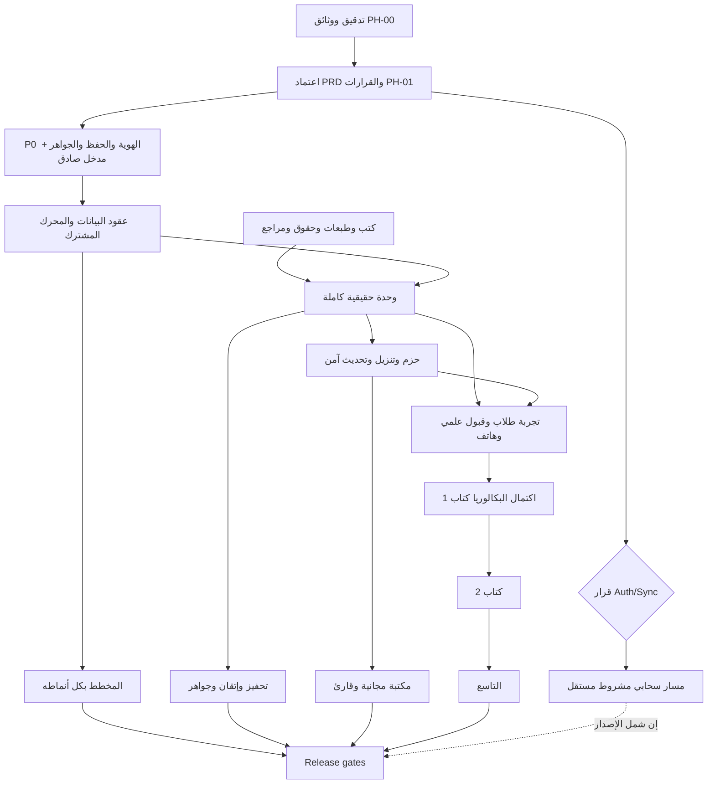

# EN.MATH — Validated Student Master Plan

التاريخ: 2026-10-25. الحالة: **VALIDATED AGAINST SOURCE / DRAFT FOR OWNER APPROVAL**. لا تفويض تنفيذ، ولا إعلان اكتمال المنتج أو المنهج.

## 1. نطاق الدليل والمرجع الحاكم

- `[VERIFIED]` يعني تحققًا ساكنًا من Working Tree، ولا يعني نجاح التشغيل أو الاعتماد العلمي.
- `[ASSUMPTION]` افتراض تخطيط يجب اختباره؛ `[BLOCKED]` اعتماد خارجي غير متوفر؛ `[PRODUCT_DECISION]` قاعدة منتج ثابتة من الخطة/أمر المالك، أو توصية موسومة بأنها تنتظر الاعتماد.
- المرجع المقروء كاملًا هو [الخطة الأصلية المؤرخة](ENMATH_STUDENT_FINAL_MASTER_PLAN_V1_2026-10-25.md)، 767 سطرًا، و[أمر التدقيق](ENMATH_CODEX_MASTER_PLAN_VALIDATION_COMMAND_2026-10-25.md). الاسم `ENMATH_STUDENT_MASTER_PLAN.md` المذكور في الأمر لا يطابق الملف الموجود؛ استُخدم الملف المؤرخ دون نسخ أو تعديل الأصل.
- لم يظهر `ENMATH_FEATURES_TECH_BACKEND_DECISION_REGISTER_2026-10-25.md` في جرد المشروع، ولا باسم بديل لسجل مماثل. كذلك لم تظهر مصادر `deep-research-report` وBlueprint وCompletion Master Roadmap المذكورة داخل الخطة. لا نزعم قراءتها؛ القرارات المفقودة لا تُستنتج من أسمائها. البديل التوثيقي الحالي [Open Decisions](ENMATH_OPEN_DECISIONS.md)، وليس إعادة إنشاء مزعومة للسجل المفقود.
- الفرع `feature/ui-refinement`، HEAD `9e47d685085c39d181e495d4e95b6306a39e4570`. النسخة المدققة تشمل التعديلات والملفات غير المتعقبة. راجع [تقرير الفجوات](../AUDITS/ENMATH_PLAN_TO_CODE_GAP_REPORT.md) للأدلة وحدود الاختبارات.

## 2. EXECUTIVE DECISIONS

1. `[PRODUCT_DECISION]` الطالب أولًا؛ التاسع والبكالوريا العلمي، حساب مستقل ثابت المرحلة لكل منهما، وقوالب مشتركة تعتمد البيانات. لا اعتماد لمقترح التقرير الاستراتيجي القديم بحساب متعدد المراحل أو محفظة مشتركة بينها؛ يتعارض مع القرار الأحدث.
2. `[PRODUCT_DECISION]` إنتاج كتاب البكالوريا الأول ثم الثاني ثم التاسع. يُختبر نموذج المرحلتين من البداية ببيانات اختبار معلنة، لا بمحتوى يُسمّى رسميًا.
3. `[PRODUCT_DECISION]` الزائر يتعلم ويخطط ويحفظ محليًا ويقرأ الموارد المجانية؛ لا Gems للزائر. لا نقل تلقائي لتقدمه أو أموالته إلى حساب آخر.
4. `[PRODUCT_DECISION]` WEEKLY + ACHIEVEMENT افتراضي؛ DAILY/WEEKLY/MONTHLY × ACHIEVEMENT/TIME_BLOCKS/HYBRID ضمن النطاق النهائي، وكل المواد قابلة للتخطيط يدويًا. لا Gems ولا ادعاء إتقان لإنجاز يدوي.
5. `[PRODUCT_DECISION]` تحفيز غير عقابي، فيزياء مجانية دائمًا للملفات المؤهلة بحقوقها، والكورسات غير المنشورة «قريبًا». المعلم والويب وAI/OCR العام خارج التنفيذ الحالي مع حفظ الكود والبيانات السابقة.
6. `[ASSUMPTION]` أقل مسار تشغيل كلفة مرشح هو local-first + كتالوج وحزم موقعة على CDN. إطلاقه بحسابات محلية أو Auth حقيقي قرار المالك D01، لا قرارًا مفروضًا بهذه الوثيقة.
7. `[VERIFIED]` لا يكفي تبديل LearningRepository: ProductGraphs وAppViewModel وLearningRules وLimitsLessonSequence وواجهات Home/Curriculum تقرأ Seed أو تربط IDs ثابتة مباشرة. يلزم فك هذه الروابط تدريجيًا.
8. `[ASSUMPTION]` نقل الهوية والزائر إلى بداية مرحلة سلامة البيانات أفضل من تأخيرهما إلى PH-06؛ نقل بيانات التقدم قبل حسم المالك يضاعف خطر الخلط. هذه مراجعة لترتيب التنفيذ وليست تغييرًا لنطاق المنتج.

## 3. CURRENT vs TARGET

مرجع المسارات هنا تحت `app/src/main/java/com/ahmadmol/enmath/`، والتفصيل في مصفوفة الشاشات وتقرير الفجوات.

| Feature | الحالة الفعلية `[VERIFIED]` | الهدف والحد الفاصل | Backlog |
|---|---|---|---|
| Shell/UI/navigation | Compose + StateFlow + graphs + header/navigation policies؛ ثيم ولغتان ومكونات مشتركة موجودة | الاحتفاظ بالأصول وإكمال حالات الفشل والوصولية؛ قبول الهاتف غير مثبت | P0-06، UX-01 |
| Authentication | AuthViewModel تحقق محلي وكود 123456؛ لا tokens أو خادم | مدخل محلي صادق، أو Auth واستعادة مثبتان بعد قرار مستقل | P0-05، CLOUD-01 |
| Guest | الدخول موجود؛ personalPrefs تستبعد Guest ولا يكتب update بيانات تعلمه إلى مخزن شخصي | UUID محلي ثابت، حفظ دائم ومراجعة claim صريحة | P0-03 |
| Grade isolation | User(name,email,type) بلا stage/edition؛ كتب مشتركة Demo | stage locked بهوية مستقلة ومنع فتح محتوى المرحلة الأخرى | P0-02 |
| Courses/curriculum | DemoContent وProductSeed؛ Home رحلة ثابتة، Curriculum بكتابين وchips ثابتة | Edition/Subject/Book/Unit/Skill ببيانات منشورة وحالة توفر دقيقة | DATA-01، CONTENT-01 |
| Dynamic lessons | LessonBlock أنواع حقيقية، لكن تسلسل النهايات ثابت ومسار خاص | محرك blocks مقيد مع source/revision، وقوالب برهان/هندسة حسب حاجة الكتاب | LEARN-01 |
| Practice/quiz | أسئلة ومجموعات Seed، حفظ Attempt تجميعي وتصحيح بسيط | محاولات per-question/version، rubric معلن وأدلة استقلال وتلميحات | LEARN-02 |
| Mastery | 40/40/20 وآخر تدريب وأفضل Quiz؛ fallback لإحصاء Seed | completion مستقل؛ أدلة مهارة وصفية ومعايرة لاحقة | LEARN-03 |
| Mistakes/review | شرح وتصحيح وإعادة تدريب موجودة؛ لا كيان دائم لدفتر الأخطاء/استحقاق المراجعة | تاريخ خطأ محفوظ، سؤال جديد، due review واقتراح خطة بموافقة | LEARN-03 |
| Solver | 7 مدخلات أمثلة منتقاة، unknown→answer=null؛ ليس CAS | حدود صريحة، مراجعة الطرق منهجيًا، سجل لكل متعلم وربط مناسب | TOOLS-01 |
| Math Lab | grammar محدود، zoom/pan/axes/grid وGraphViewport؛ قطع منحنى بهيوريستك قفزة بكسلية | مجموعة دوال معتمدة واختبارات انقطاع ومجالات؛ 1/x غير مدعومة حاليًا | TOOLS-02 |
| Planner | لا StudyPlan/Goal/Session أو Route للمخطط | كل الأنماط التسعة، كميات جزئية وتاريخ ونقل اختياري | PLAN-01..03 |
| Motivation/achievements | نصوص تشجيعية وعناصر رحلة؛ لا نظام دائم مستقل مع cadence | catalog رسائل + event rules + إعدادات + شارات مثبتة | MOT-01 |
| Gems | SQLite بمعاملات وقيود ومكافآت وصاحب بريد؛ Demo +1000 ومسار سعر غير متسق؛ weekly reward موجود | إصلاح invariant دون تصفير؛ سياسة أسبوعية تحتاج اعتمادًا؛ لا reward يدوي | P0-04، MOT-02 |
| Library | محفوظات دروس/حلول وموارد صفية؛ guest محجوب بـProtectedContent | موارد عامة بحقوق وalwaysFree، PDF/last page/offline بلا Teacher | LIB-01..02 |
| Offline packs | المحتوى الحالي داخل APK؛ لا تنزيل/manifest/signature/install lifecycle | كتالوج موقّع، تحقق وتفعيل ذري وتحديث/repair/delete للمحتوى فقط | PACK-01..03 |
| Storage | SharedPreferences/JSON + SQLite مستقل للجواهر؛ لا Room/DataStore | هوية ملكية أولًا، Room مقترح بمهاجرات إضافية وعقود محددة | P0-01..04، DATA-01 |
| Backend | وثيقة مستقبلية، لا خدمة إنتاجية مثبتة في المستودع | CDN أولًا كمرشح؛ API/Auth/Sync حسب بوابات مستقلة | CLOUD-01 |
| Settings/search/inbox | حفظ لغة/ثيم/تفضيل تنبيه، بحث محلي ومحفوظاته؛ inbox Demo بلا جدولة نظامية | صدق الحالات وفلترة المرحلة ومصادر موارد/حزم، خصوصية ومساعدة وإبلاغ | AUX-01، REL-01 |
| Official coverage | لا كتب رسمية أو تغطية مراجعة مثبتة | `BLOCKED_BY_TEXTBOOK`؛ لا عدد وحدات أو أسئلة رسمي مفترض | CONTENT-01..04 |

لا توجد ميزة يمكن اعتمادها هنا «مكتملة إنتاجيًا». الأجزاء المحلية المحدودة التي تم التحقق من تنفيذها تشمل تفضيلات اللغة والثيم، سياسات navigation، بعض منطق التصحيح والتكرار، وledger الجواهر الأساسي؛ تبقى بوابات التكامل والهاتف والعلوم.

## 4. مواصفات المنتج المنقحة

### الهوية والدخول

`[PRODUCT_DECISION]` مسار أول استخدام: تعريف قابل للتخطي → اختيار المرحلة → هوية زائر مستقلة ثابتة المرحلة أو حساب مؤهل → الوجهة التعليمية. تغيير المرحلة يتطلب هوية/حسابًا آخر مع تفسير واضح. البريد والهاتف بيانات اتصال قابلة للتغيير وليسا مفاتيح تقدم. الحسابان المرحليان لا يشتركان بالمحفظة ضمنيًا. سياسة رقم واحد لحسابين تنتظر D02.

`[BLOCKED]` Auth الإنتاجي: اختبار تحقق واستعادة من سوريا وأهلية فتح الخدمة والدفع والتكلفة. لا تُسوّق شاشات Demo كتسجيل حقيقي. دمج Guest يحتاج موافقة محددة، ملكية مؤكدة، مقارنة بيانات، idempotency وjournal؛ لا جمع رصيدين.

### الحلقة التعليمية

`[PRODUCT_DECISION]` درس بهدف ومصدر وطبعة → مثال → محاولة مستقلة → تفسير → خطأ محفوظ ومراجعة → تقدم/خطة/خطوة تالية. الدرس المكتمل ليس مهارة متقنة. محتوى draft/reviewed/published؛ كل سؤال له revision/rubric/source/skill. البرهان الحر غير المدعوم يعرض نموذجًا ومراجعة ذاتية دون تصحيح آلي جازم.

`[ASSUMPTION]` البداية بأنواع Choice/TrueFalse/Numeric وExpression محدد الدعم؛ المطابقة والترتيب والاختيار المتعدد مطلوبة في PRD لكن تفعيل كل نوع مشروط بحاجة الكتاب وإثبات المصحح. لا تتوسع grammar قبل عينات الكتب.

### المخطط والتحفيز والجواهر

`[PRODUCT_DECISION]` Goal(unit,targetQty) + ProgressEvent، linked/manual. إنجاز 2/4 يبقى 2/4، وإحصاء الخطة الإجمالي بنسبة أهداف مكتملة لا بجمع الصفحات والوحدات. تعديل الهدف يحفظ التاريخ، ونقل المتبقي للفترة القادمة قرار صريح لا ينسخ الإنجاز. timezone تقويمية؛ الوقت لا يثبت تعلمًا.

`[PRODUCT_DECISION]` رسائل محلية منتقاة قابلة للتعطيل وتحديد الوتيرة، لا مقاطعة الحل أو عقوبة يوم راحة. الشارات منفصلة عن ledger. سياسة streak/weekly ومقدار المكافآت المقترحة لا تعتمد كمنتج لمجرد وجود enum؛ راجع D06. رصيد محلي لا يثبت حقوق شراء مالية مستقبلية.

### الموارد والحزم

`[PRODUCT_DECISION]` موارد الفيزياء المرخصة alwaysFree، قابلة للقراءة دون حساب وبعد التنزيل دون شبكة. الكورس غير المنشور يظهر قريبًا ولو كانت ملفاته العامة متاحة. PDF reader والتخزين وآخر صفحة وbookmarks وحالة المساحة وظائف مطلوب بناؤها.

`[ASSUMPTION]` APK يحمل shell + كتالوج صغير + وحدة بداية معتمدة. الحزم بيانات blocks لا شيفرة تنفيذية، media اختيارية منفصلة، وحياة التحميل مستديمة وآمنة. حذف الحزمة لا يحذف learner records. الجلسة تثبّت content/rubric revision حتى انتهائها.

### الواجهة والعقود

`[PRODUCT_DECISION]` الاحتفاظ بالتنقل الحالي قبل اعتماد IA بديلة. `Routes.tabs` ترتيبها البرمجي Study/Solver/Home/Explore/Profile؛ لا يُفهم ترتيب القائمة الوصفي في الخطة باعتباره ترتيب العرض الجديد. مكونات مشتركة للمرحلتين مع اختلاف البيانات، وتفاصيل lesson/math باتجاه LTR داخل RTL.

`[BLOCKED]` القبول البصري وTalkBack/×2/IME/scroll/low-memory على هاتف حقيقي لم يُنفذ في هذا التدقيق. كل شاشة تغطي Ready/Empty/Loading/OfflineMissing/Error/Permission حيث يلزم؛ سجل الشاشات يميز الحالي من المطلوب.

## 5. DEPENDENCY GRAPH وبوابات الإصدار

ترتيب PH-02/03 وPH-06 الأصلي مُدمج عند الهوية؛ PH-04 لا يبدأ محتواه الحقيقي دون الكتب. النموذج والاختبارات الاصطناعية المعلنة يمكن إعدادها قبلها بعد الإذن. PH-07/08/09 ليست أسبابًا لتأخير سلامة البيانات؛ تتكامل بعد عقد الأحداث والحزم. لا تفويض عمل متوازٍ أو كتابة كود من هذا المخطط.

| Release | بوابة القبول | الحالة |
|---|---|---|
| R0 architecture review | الوثائق + أدلة + اعتماد المالك | التقرير موجود؛ الاعتماد معلق |
| R1 vertical slice | وحدة حقيقية + محاولة جديدة + مراجعة + خطة + بقاء البيانات + offline | BLOCKED_BY_TEXTBOOK وتنفيذ لاحق |
| R2 pilot | تجربة طلاب وأجهزة وشبكات، سجل أخطاء وإصلاح | غير منفذ |
| R3 Bac book 1 | 100% أهداف الطبعة المراجعة لا 100% Demo | BLOCKED_BY_TEXTBOOK |
| R4 Bac complete | الكتابان بالمعايير نفسها | BLOCKED_BY_TEXTBOOK |
| R5 Student complete | التاسع والكتابان + جميع ميزات PRD + جهاز/علم/حقوق/خصوصية | غير جاهز |
| R6 future | معلم/ويب/AI/Sync متقدم حسب قرار منفصل | خارج النطاق |

## 6. LOW-COST STRATEGY

ثلاثة سيناريوهات موثقة تفصيلًا في [Target Architecture](../ARCHITECTURE/ENMATH_TARGET_ARCHITECTURE_DRAFT.md): A محلي + Content CDN، B يضيف API صغيرًا لغرض مثبت، C يضيف Auth/Postgres/Sync عند اعتماد وعد الاستعادة. لا إنشاء خدمة أو شراء في هذه المهمة. السعر المعلن لا يثبت توفرًا أو نجاح تنزيل أو استعادة من سوريا.

## 7. أول مرحلة قابلة للاعتماد

حزمة P0-01..06: fixtures/journal وحماية JSON، IDs وstage lock، حفظ Guest، تسوية خلل Gems، فصل مدخل Demo عن إنتاج، عقود جلسة ومالك وتنقل. التفاصيل والاختبارات وDoD في [Backlog](ENMATH_EXECUTION_BACKLOG.md). الجزء التمهيدي لوحدة تعليمية هو DATA-01/CONTENT-01؛ تحرير محتواها الحقيقي محجوب بالكتب. لا يُنفذ أي بند قبل موافقة المالك.

## 8. Definition of Ready / Done

Ready: story لها مستخدم/مرحلة وقرار مرجعي، عقد بيانات وملكية، UX states، ملفات متأثرة، مخاطر ترحيل/حقوق، Given/When/Then واختبارات، وموافقة على المرحلة. Done: أدلة اختبارات مناسبة، حفظ وعزل وفشل مختبران، لا هجرة مدمرة، اعتماد هاتف للعرض وتكامل فعلي، واعتماد علمي للمحتوى. لم تتحقق هذه البوابات بمجرد إعداد الوثائق.

ملفات التسليم المكملة: [PRD](ENMATH_STUDENT_FINAL_PRD_DRAFT.md)، [Screens](ENMATH_STUDENT_SCREEN_MATRIX.md)، [Backlog](ENMATH_EXECUTION_BACKLOG.md)، [Architecture](../ARCHITECTURE/ENMATH_TARGET_ARCHITECTURE_DRAFT.md)، [QA](../QA/ENMATH_STUDENT_RELEASE_ACCEPTANCE_MATRIX.md)، [Decisions](ENMATH_OPEN_DECISIONS.md)، [Gaps](../AUDITS/ENMATH_PLAN_TO_CODE_GAP_REPORT.md).
